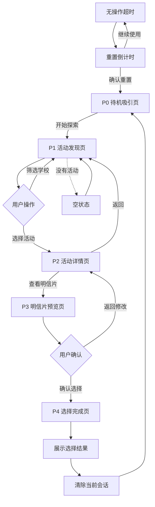

# 德志广场互动树｜屏幕端产品开发交接文档

**版本：** V1.0  
**日期：** 2026-11-01  
**项目：** 基于实践的设计研究方法｜澳琴国际教育大学城  
**开发目标：** 高保真交互界面 + 可运行网页原型

---

# 01. 项目定位

## 1.1 项目背景

本项目服务于澳琴国际教育大学城德志广场，涉及澳门大学、澳门理工大学和澳门旅游大学三所学校。

我们希望通过一个具有节日主题和校园文化特色的互动屏幕，让广场访客了解近期校园活动，并通过交互体验加深对活动和大学城的印象。

屏幕是一个独立的校园活动探索产品。

它的主要任务是：

1. 展示大学城近期的校园活动。
2. 帮助访客发现感兴趣的活动。
3. 让访客了解活动详情。
4. 让访客选择活动并预览对应的纪念明信片。
5. 完成一次有趣、完整的数字交互体验。

## 1.2 本次开发范围

**只开发数字屏幕端。**

包含：
- 高保真 UI 视觉设计。
- 完整页面信息架构。
- 页面之间的交互逻辑。
- 活动浏览与筛选。
- 活动详情展示。
- 明信片预览与翻转。
- 用户选择与确认。
- 节日主题视觉系统。
- 页面动画与交互反馈。
- 浏览器端完整体验流程。
- 适合触摸屏使用的布局与交互。

明确不包含：
- 任何秋千功能。
- 任何明信片实体投递功能。
- 电路、传感器及硬件控制。
- 机械结构。
- 设备通信接口。
- 后台管理系统。
- 用户登录、账户体系及个人中心。

本项目完成标准是：访客可以在网页中完整体验所有数字页面和交互，所有操作都能在浏览器中实际运行。

注意：选择完成页面只代表数字端选择成功，不代表任何实体设备已经执行操作。

---

# 02. 产品体验设计

## 2.1 核心体验

产品的核心流程：

发现活动 → 浏览活动 → 了解活动 → 预览明信片 → 确认选择 → 完成体验。

产品应该让访客在很短的时间内理解自己可以做什么。

不需要长篇说明，也不需要复杂的学习成本。

## 2.2 目标用户

主要用户：
- 经过德志广场的大学城访客。
- 三所大学的在校学生。
- 教师及教职人员。
- 参与校园活动的来访者。
- 对大学城文化和活动感兴趣的人。

设计时不要假设访客熟悉学校内部组织和活动名称。

界面需要做到直观、易读、容易操作。

## 2.3 产品设计原则

1. 第一眼有吸引力：让访客愿意主动触摸屏幕。
2. 内容优先：活动本身是主角，不让装饰压过信息。
3. 操作简单：尽量让访客通过点击完成所有操作。
4. 有趣但不幼稚：允许更活泼的图形、字体、色彩和交互。
5. 有连续体验：页面切换应该有自然的视觉衔接。
6. 有明确反馈：每次点击都应该产生可感知的结果。
7. 适合公共空间：文字清晰、按钮足够大，不依赖悬停操作。

---

# 03. 视觉设计方向

## 3.1 推荐设计概念

**Campus Postcard Explorer｜校园探索手册**

将整个屏幕想象成一本可以互动的校园活动探索手册。

访客浏览的不是传统网站的菜单和信息卡片，而是一个不断展开的校园活动收藏空间。

设计可以从以下元素中提取灵感：

- 明信片与邮票。
- 邮戳、印刷纹理和纸张边缘。
- 手绘箭头、涂鸦和贴纸。
- 树叶、自然形态和校园空间。
- 活动海报和杂志排版。
- 剪贴簿、纸本档案和收藏册。
- 有趣的数字插画和动态图形。

这些元素不需要全部堆在一个页面中，而是形成统一的视觉语言。

## 3.2 明确的审美要求

本项目不采用典型的 Apple 风格。

避免：
- 全部组件采用统一的大圆角。
- 全白背景加浅灰卡片。
- 过度整洁、缺乏个性的 SaaS 风格。
- 传统企业后台式布局。
- 每个区块都套一个圆角矩形。
- 过度依赖极简排版。
- 只通过渐变、阴影制造所谓高级感。
- 过度使用科技感、赛博朋克或电竞 RGB。

鼓励：
- 不对称构图。
- 多样化的几何形态。
- 有个性的字体组合。
- 大胆但有秩序的色彩。
- 纸张、印刷、贴纸等材质表现。
- 插画与真实活动图片结合。
- 富有节奏感的排版。
- 具有记忆点的页面转场。
- 有趣的按钮反馈和卡片交互。

整体气质应该是：

**活泼、亲切、有创意、有校园文化气息，同时具备完整的设计感。**

不能变成儿童教育网站，也不能变成一个普通的商业活动宣传页。

## 3.3 视觉系统建议

以下是初步方向，不是最终锁定的设计规范。

| 维度 | 建议 |
|---|---|
| 主视觉 | 插画、活动海报、明信片 |
| 背景 | 纸张质感、色块、自然图形 |
| 配色 | 暖色基础色搭配鲜明的辅助色 |
| 字体 | 有表现力的标题字体 + 易读正文 |
| 组件 | 不规则边缘、贴纸、邮票、标签 |
| 图形 | 手绘、印刷、剪贴与自然元素 |
| 动效 | 纸张翻转、印章盖下、图形展开 |
| 交互 | 点击、翻转、切换、拖动等有意义的操作 |

注意：
- 不得随意伪造三所大学的官方 Logo。
- 不得擅自将某种颜色定义为某所学校的官方品牌色。
- 正式素材优先使用用户提供或官方公开素材。
- 没有正式素材时，使用风格统一的原创插画或明确的占位素材。

---

# 04. 信息架构

整个屏幕采用五个主要页面。

## P0｜待机吸引页

页面职责：吸引访客开始探索。

主要内容：
- 当前节日主题。
- 项目名称或主题标题。
- 精选校园活动。
- 活动宣传视觉。
- 开始探索按钮。

页面可以有轻微的动态效果，例如：
- 插画缓慢运动。
- 装饰元素轻微漂浮。
- 精选活动视觉轮播。
- 按钮出现自然的动态反馈。

避免自动轮播速度过快。

## P1｜活动发现页

页面职责：让访客发现感兴趣的活动。

主要内容：
- 页面标题。
- 全部活动。
- 三所学校筛选。
- 近期活动列表。
- 活动海报。
- 活动时间。
- 活动类型标签。

学校筛选：

- 全部
- 澳门大学
- 澳门理工大学
- 澳门旅游大学

第一版不需要复杂搜索框和多级分类。

活动呈现方式不限定为传统卡片网格。可以尝试活动海报墙、编辑式列表或不对称内容布局。

## P2｜活动详情页

页面职责：帮助访客了解活动。

主要内容：
- 活动宣传图片。
- 活动名称。
- 所属学校。
- 活动时间。
- 活动地点。
- 活动介绍。
- 活动类型。
- 查看对应明信片的操作入口。
- 返回活动列表。

内容应具有真实活动宣传页面的完整性。

## P3｜明信片预览与确认页

页面职责：让访客查看与当前活动对应的纪念明信片。

主要内容：
- 明信片正面。
- 明信片背面。
- 活动相关文字。
- 明信片主题设计。
- 返回修改。
- 确认选择。

可以采用具有真实纸张质感的翻转交互。

点击明信片可以翻转正反面。

明信片应自动根据当前活动加载，不需要访客再次寻找或选择其他卡片。

## P4｜选择完成页

页面职责：完成本次数字选择流程。

主要内容：
- 完成状态。
- 已选择的活动。
- 对应明信片展示。
- 简短完成文案。
- 返回首页按钮。

完成页面需要有一个令人记住的视觉反馈，例如印章盖下、明信片收录进收藏册等。

不要在页面上显示未经验证的实体投递成功信息。

---

# 05. 用户交互流程



## 5.1 交互规则

1. 一次浏览会话默认只确认一个活动。
2. 用户可以在确认之前随意返回、更换活动。
3. 返回活动列表时保留之前的学校筛选和浏览位置。
4. 活动必须与明信片建立对应关系。
5. 每个活动使用唯一 eventId。
6. 每张明信片使用唯一 postcardId。
7. 用户确认时保存当前活动编号及对应明信片编号。
8. 完成页面展示正确的选择结果。
9. 用户点击返回首页后，清空本次会话。
10. 刷新页面或会话超时后，回到待机页面。

## 5.2 自动重置

初版建议：

- 90 秒无操作：显示即将重置提示。
- 进入 15 秒倒计时。
- 用户继续操作：取消倒计时。
- 倒计时结束：清空会话，返回待机页。

时间应当可配置，后续根据实际使用测试调整。

---

# 06. 内容数据结构

建议使用独立的数据文件，避免把活动信息直接写死在页面组件中。

## 6.1 学校 School

```ts
interface School {
  id: string;
  name: string;
  nameEn?: string;
  logo?: string;
}
```

## 6.2 活动 Event

```ts
interface Event {
  id: string;
  title: string;
  schoolId: string;
  category: string;
  startTime: string;
  endTime?: string;
  location: string;
  description: string;
  coverImage: string;
  postcardId: string;
  status: "upcoming" | "ongoing" | "ended";
  featured?: boolean;
}
```

## 6.3 明信片 Postcard

```ts
interface Postcard {
  id: string;
  eventId: string;
  frontImage: string;
  backImage: string;
  postcardText: string;
}
```

## 6.4 节日主题 Theme

```ts
interface Theme {
  id: string;
  name: string;
  background: string;
  colorPalette: Record<string, string>;
  decorations: string[];
  animationPreset?: string;
}
```

## 6.5 数据关联规则

```text
School
  └── Event
        └── Postcard
```

- 一个学校可以有多个活动。
- 每个可参与选择的活动必须有对应明信片。
- 每个活动通过 postcardId 找到明信片。
- 当前启用的 Theme 统一作用于所有页面。

没有实际活动数据时，可以先使用明确标记的演示数据。不要虚构真实的学校官方活动、日期或主办信息。

---

# 07. 网页端交互实现要求

## 7.1 基本要求

开发成一个可以通过浏览器直接运行的完整网页应用。

如果项目中已经存在技术栈，优先沿用。

如果没有现成项目，建议采用：

- React
- TypeScript
- Vite
- CSS / Tailwind（根据视觉实现需要决定）
- Framer Motion 或项目现有的动画方案

不需要后端。

第一版采用本地结构化数据和前端状态管理即可。

## 7.2 交互必须真实可用

不能只做静态页面截图。

必须实现：

- 首页进入活动列表。
- 学校筛选。
- 活动列表更新。
- 活动详情切换。
- 返回上一页面。
- 明信片正反面翻转。
- 活动与明信片自动匹配。
- 确认选择。
- 完成页面。
- 清空当前会话。
- 自动超时重置。

所有主要按钮必须有实际作用。

不允许出现看起来可以点击、实际上没有任何功能的按钮。

## 7.3 交互状态

至少处理：

- 默认状态。
- 选中状态。
- 按下状态。
- 页面切换状态。
- 无活动状态。
- 活动无对应明信片状态。
- 超时提醒状态。
- 页面重置状态。

## 7.4 触摸屏适配

主要目标是公共空间中的大屏触摸操作。

暂定设计基准：

- 横屏 16:9。
- 1920 × 1080 作为主要设计视口。
- 同时检查 1366 × 768。
- 使用响应式尺寸和合理的内容缩放。

以上屏幕比例属于开发假设，最终需要根据实际设备调整。

要求：

- 主要操作按钮足够大。
- 触摸区域建议不小于 48 × 48 CSS px，重要操作可以更大。
- 不依赖 hover 才能显示关键操作。
- 不使用需要精确拖动才能完成的必要流程。
- 不允许内容被屏幕边缘裁切。
- 中文正文在实际观看距离下保持可读。
- 页面主要交互尽可能在当前屏幕内完成。
- 活动数量较多时，只允许内容区域独立滚动，不要让整个界面失去操作结构。

同时保留基本的键盘操作能力，方便开发和测试。

---

# 08. 动效与交互体验规范

本项目需要有一定的趣味性和表现力。

但动效必须服务于内容和操作。

建议重点打造以下体验：

| 场景 | 动效方向 |
|---|---|
| 待机页 | 主题插画自然运动、轻微漂浮 |
| 进入活动页 | 活动内容有节奏地展开 |
| 筛选学校 | 活动列表自然切换 |
| 打开活动详情 | 海报与内容形成连续过渡 |
| 明信片预览 | 正反面翻转 |
| 确认选择 | 印章盖下、贴纸贴合等反馈 |
| 完成页面 | 明信片进入收藏展示效果 |

动效要求：

1. 不要每个元素都同时运动。
2. 重要动作需要明显的视觉反馈。
3. 动画速度不能影响公共空间的操作效率。
4. 页面切换需要保持连贯。
5. 触摸操作需要有明确的按压反馈。
6. 避免过多弹跳、旋转和夸张缓动。
7. 支持 prefers-reduced-motion。
8. 确保动画不会导致页面布局跳动。

优先使用 CSS、JS 和现有动画库完成常规交互，不要为了简单的按钮动画引入复杂的视频序列方案。

---

# 09. Codex 开发工作流

本项目采用以下开发顺序。

## 阶段 0｜项目盘点与 Skill 准备

1. 检查现有项目目录。
2. 识别现有技术栈。
3. 读取项目级 AGENTS.md。
4. 检查用户已经安装的相关 Skills。
5. 读取用户提供的视觉参考和素材。
6. 确认可复用组件、图片及字体资源。
7. 整理项目最小规划记录。

不要擅自重建已有项目，不要重复安装已经存在的 Skill。

## 阶段 1｜视觉方向与高保真设计

这是整个项目最重要的阶段之一。

1. 根据本交接文档建立视觉方向。
2. 使用适合的 UI 设计 Skill。
3. 参考用户提供的案例与设计素材。
4. 探索具有辨识度的视觉表达。
5. 完成统一的色彩、字体、布局、组件规范。
6. 完成五个核心页面的高保真设计。
7. 完成主要交互状态的设计。
8. 检查五个页面是否属于同一个设计系统。

不要只做一个漂亮的首页。

必须覆盖完整流程。

## 阶段 2｜前端结构与组件实现

1. 建立页面结构。
2. 建立共享视觉组件。
3. 建立活动数据文件。
4. 建立明信片数据文件。
5. 建立主题配置。
6. 建立会话状态管理。
7. 实现页面跳转。

组件需要合理复用，但不要为了抽象而制造过多层级。

## 阶段 3｜完整交互实现

依次完成：

- 首页进入。
- 活动浏览。
- 学校筛选。
- 活动详情。
- 明信片预览。
- 正反面翻转。
- 确认选择。
- 完成反馈。
- 返回首页。
- 自动重置。

这一阶段必须保证整个体验能够连续运行。

## 阶段 4｜视觉精修与验收

通过真实浏览器运行页面。

检查：

- 五个页面的视觉一致性。
- 字体、颜色和布局。
- 图片质量及裁切。
- 触摸区域。
- 按钮反馈。
- 页面转场。
- 明信片翻转。
- 不同屏幕尺寸。
- 无内容、无明信片等异常状态。
- 长时间无操作的重置流程。

需要提供实际浏览器截图，不能只根据源码判断页面是否美观。

---

# 10. 最终交付要求

本项目最终需要交付：

### A. 高保真 UI

- 五个完整页面。
- 统一设计系统。
- 页面关键状态。
- 明信片正反面视觉。
- 节日主题视觉配置。

### B. 可运行网页

- 可直接启动的网页项目。
- 完整页面交互。
- 真实可用的按钮。
- 活动筛选。
- 明信片翻转。
- 确认流程。
- 自动重置。
- 本地演示数据。

### C. 设计与技术文档

建议在项目中保留：

```text
docs/
  PRODUCT_BRIEF.md
  INFORMATION_ARCHITECTURE.md
  USER_FLOW.md
  DESIGN_SYSTEM.md
  INTERACTION_SPEC.md
  IMPLEMENTATION_NOTES.md
  QA_REPORT.md
```

文档只记录实际采用的决定，不要为了数量重复生成内容。

### D. 验收证据

- 五个页面的实际运行截图。
- 关键交互录屏或截图。
- 浏览器测试结果。
- 已知问题及未完成事项。

---

# 11. 开发边界与质量要求

1. 不得擅自扩展成校园综合门户。
2. 不得加入用户登录、注册、个人中心。
3. 不得加入无关的活动报名和支付功能。
4. 不得开发后台管理系统。
5. 不得开发任何实体设备控制功能。
6. 不得把界面做成传统 SaaS Dashboard。
7. 不得以增加卡片数量代替视觉设计。
8. 不得只完成静态首页。
9. 不得使用未经确认的真实校园活动信息。
10. 不得将构建成功当成视觉验收成功。

优先保证产品体验完整、视觉有辨识度、交互稳定。

---

# 12. 本项目的 Skill 与参考资源使用规范

用户后续会提供自己的 Skills、组件库和视觉参考。

Codex 应先检查现有 Skill，再根据任务调用。

不要将所有 Skill 一股脑叠加。

优先区分：

- 视觉方向探索。
- 高保真 UI 设计。
- 动效与微交互。
- 前端功能实现。
- 浏览器测试。

每种能力选择真正适合的工具。

用户提供的 Skill 和参考优先于默认模板，但不能为了套用某个 Skill 而改变产品定位。

如果某个 Skill 的风格与本项目的趣味性、公共触摸屏和校园文化定位冲突，应当拒绝不合适的默认做法。

---

# 13. 当前待确认事项

以下信息暂时不应被当成已经确定的事实：

1. 实际屏幕的物理尺寸及最终宽高比。
2. 是否需要中英文双语切换。
3. 三所学校的官方 Logo 和可用视觉资产。
4. 实际校园活动数据及活动宣传图片。
5. 最终明信片的真实设计文件。
6. 最终节日主题及启用顺序。

这些信息不应阻止第一版开发。

可以先使用可替换的本地数据和视觉占位资源，并把相关配置独立管理。

---

# 14. 给 Codex 的正式任务

请将本交接文档作为本项目屏幕端开发的产品基线。

现在开始进行项目盘点、Skill 检查和开发准备。

请注意：

- 本项目的重点是高保真 UI 和完整可运行的网页交互。
- 视觉方向需要具有趣味性、创意性和记忆点。
- 不要默认使用 Apple 式极简设计。
- 不要把它做成普通校园活动网站。
- 不要只做静态设计图。
- 最终必须有真正能够操作的网页原型。

用户可能会在本任务开始时追加其他 Skills、视觉参考和设计素材。请将这些内容纳入本项目的设计和实施过程。

如果某项前置条件不会影响整体方向，不必停下来反复询问，可以采用合理假设继续推进，并将假设记录在项目文档中。

如果遇到会明显改变产品体验的关键冲突，再向用户提出一个明确的问题。

**本轮目标：交付一套具有独特视觉表达、完整交互链路、可以在浏览器中实际运行的校园活动探索屏幕。**